# The 7 Habits of Highly Effective People — Stephen R. Covey

> *I'm starting a journey into self-help — improving myself not just by reading books, but by breaking them down and sharing what I learn. The goal is simple: get better, and pass on what's useful to the people around me. No gatekeeping, no fluff — just the ideas that actually change how you think and live.*

| | |
|---|---|
| **Title** | The 7 Habits of Highly Effective People: Powerful Lessons in Personal Change |
| **Author** | Stephen R. Covey |
| **Published** | 1989 |
| **Category** | Self-Help · Personal Development |

## TL;DR

- Lasting effectiveness comes from **character** — principles like integrity, fairness, and patience — not from personality tricks and quick fixes. Covey calls this the **Character Ethic** vs. the **Personality Ethic**.
- Real change works **"inside-out"**: you fix yourself first, before trying to change your circumstances or the people around you.
- Growth follows a **Maturity Continuum**: **Dependence → Independence** (Habits 1–3, the *Private Victory*) **→ Interdependence** (Habits 4–6, the *Public Victory*).
- **Habit 7 (Sharpen the Saw)** renews you across body, mind, heart, and spirit — it's what keeps the other six sustainable.
- **Who it's for:** anyone who wants durable, principle-based personal and relational effectiveness instead of motivational hacks.

## Overview

*The 7 Habits of Highly Effective People* (1989), by Stephen R. Covey, argues that true effectiveness isn't a matter of techniques, charisma, or shortcuts — it grows out of **character** and timeless **principles**. Covey's central claim is that we see the world through **paradigms** (mental maps), and that meaningful change begins by shifting those paradigms and working from the **inside-out**: private character before public success. The book organizes personal growth into seven habits that move a person from **dependence** to **independence** and finally to **interdependence** — the mature ability to work effectively with others. It's less a productivity manual than a framework for building a principled, effective life.

> **Note:** These are personal summary notes and cannot substitute for the book itself—the book contains much more detail, nuance, and context that readers will find helpful. Not affiliated with or endorsed by the author or publisher; all rights to the original work belong to them.

## Content

Here's the structure of *The 7 Habits* (click to jump to each summary):

**Foundations — Paradigms and Principles**
1. [**Inside-Out** — How We See the World Shapes Everything](#1-inside-out--how-we-see-the-world-shapes-everything)
2. [**The Seven Habits — An Overview** — The Maturity Continuum and the P/PC Balance](#2-the-seven-habits--an-overview)

**Private Victory — From Dependence to Independence**

3. [**Habit 1: Be Proactive** — The Principle of Personal Responsibility](#3-habit-1-be-proactive--the-principle-of-personal-responsibility)
4. [**Habit 2: Begin with the End in Mind** — The Principle of Vision](#4-habit-2-begin-with-the-end-in-mind--the-principle-of-vision)
5. [**Habit 3: Put First Things First** — The Principle of Prioritization](#5-habit-3-put-first-things-first--the-principle-of-prioritization)

**Public Victory — From Independence to Interdependence**

6. [**Paradigms of Interdependence** — The Emotional Bank Account](#6-paradigms-of-interdependence--the-emotional-bank-account)
7. [**Habit 4: Think Win/Win** — The Principle of Mutual Benefit](#7-habit-4-think-winwin--the-principle-of-mutual-benefit)
8. [**Habit 5: Seek First to Understand, Then to Be Understood** — The Principle of Empathic Communication](#8-habit-5-seek-first-to-understand-then-to-be-understood--the-principle-of-empathic-communication)
9. [**Habit 6: Synergize** — The Principle of Creative Cooperation](#9-habit-6-synergize--the-principle-of-creative-cooperation)

**Renewal**

10. [**Habit 7: Sharpen the Saw** — The Principle of Balanced Self-Renewal](#10-habit-7-sharpen-the-saw--the-principle-of-balanced-self-renewal)
11. [**Inside-Out Again** — Living the Habits](#11-inside-out-again--living-the-habits)

---

## 1. Inside-Out — How We See the World Shapes Everything

### The Character Ethic vs. the Personality Ethic

From studying 200 years of "success" writing, Covey finds a split:

- **The Character Ethic** (the first ~150 years) taught that effectiveness is built on **deep character**—integrity, humility, courage, justice, patience. Success is something you *become*.
- **The Personality Ethic** (the last ~50 years) reframed success as **image and technique**—charm, positive thinking, communication tricks. Success is something you *project*.

His verdict: the Personality Ethic is **superficial**. Its techniques may work briefly, but they treat the surface, not the root. This is the **Law of the Harvest**—you reap what you sow, and you can't cram on a farm.

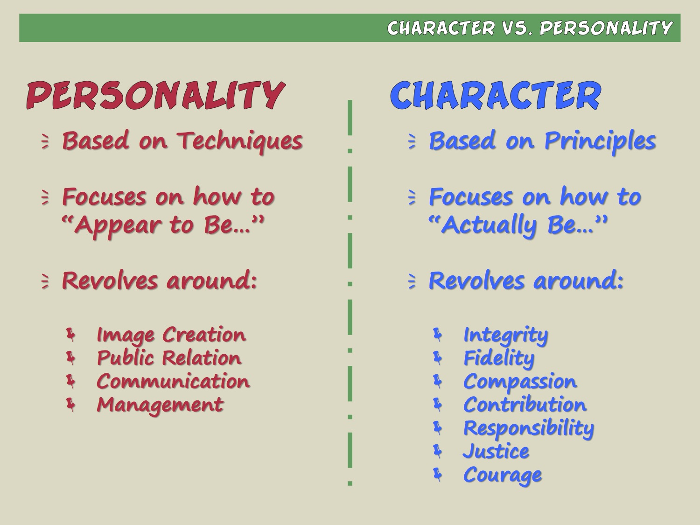

### Paradigms: The Maps in Our Heads

A **paradigm** is a mental map—the way we see and interpret the world. **We don't see the world as it is; we see it as we are.** Covey's analogy: navigating a city with the *wrong map*. Trying harder or thinking positive won't get you there—you need the *right map*. A **paradigm shift** is the "aha" moment when the map suddenly changes and your whole perception transforms.

### Principles and the Inside-Out Approach

Effectiveness rests on **principles**—timeless natural laws like fairness, integrity, honesty, and human dignity. Principles *are the territory*; our values are just the map, and the closer the map aligns to principles, the more effective we are.

The core thesis: **real change moves from the inside out.** You start with yourself—your own paradigms, character, and motives—before working outward to circumstances and relationships. **Private victories precede public victories.**

---

## 2. The Seven Habits — An Overview

### The Maturity Continuum

The seven habits move a person along a continuum of growth:

- **Dependence** (the *you* paradigm)—*you* take care of me; I blame you. Where we all start.
- **Independence** (the *I* paradigm)—*I* can do it; I am responsible and self-reliant.
- **Interdependence** (the *we* paradigm)—*we* can combine our talents to create something greater together.

Society prizes independence as the endpoint, but Covey argues **interdependence is a higher, more mature level**—and you can only reach it *from* genuine independence. This maps directly onto the habits:

- **Habits 1–3 → Private Victory:** self-mastery. They move you from **dependence to independence**.
- **Habits 4–6 → Public Victory:** teamwork, empathy, cooperation. They move you from **independence to interdependence**.
- **Habit 7 → Renewal:** it surrounds and renews the other six.

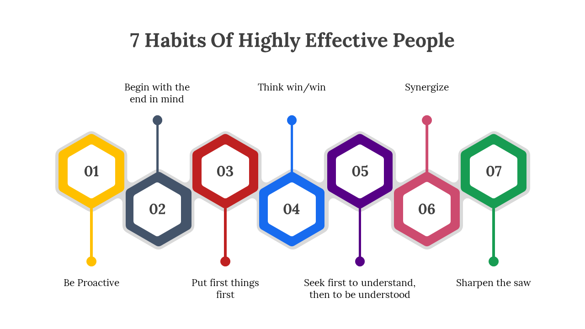

### Effectiveness Defined: The P/PC Balance

Covey grounds "effectiveness" in **Aesop's fable of the goose and the golden eggs.** A farmer, greedy for all the golden eggs at once, kills the goose—and ends up with nothing.

The lesson is a balance between two things:

- **P = Production**—the golden eggs; the results you want *now*.
- **PC = Production Capability**—the goose; the *asset* that produces the results.

**True effectiveness is a function of both.** Overfocus on P (squeezing results) destroys PC (you burn out the asset or relationship); overfocus on PC while neglecting P is impractical. It applies to **physical, financial, and—most importantly—human assets** and relationships.

### What the Book Promises

Covey frames the seven habits as an **incremental, sequential, integrated** approach—not a grab-bag of tips. Each builds on the last, and together they form a whole.

---

## 3. Habit 1: Be Proactive — The Principle of Personal Responsibility

The first habit, and the foundation for all the others: taking responsibility for your own life.

### The Space Between Stimulus and Response

Covey's central idea comes from Viktor Frankl, the psychiatrist who survived Nazi death camps. Stripped of everything, Frankl realized his captors could control his environment but not his inner response—he retained **"the last of the human freedoms": the freedom to choose one's attitude in any given set of circumstances.**

Between what happens to us (**stimulus**) and how we react (**response**), there is a **space**. In that space lies our **freedom and power to choose**. What makes this possible are four uniquely human gifts:

- **Self-awareness** — the ability to observe our own thoughts and behavior.
- **Imagination** — the ability to envision beyond present reality.
- **Conscience** — an inner sense of right, wrong, and principles.
- **Independent will** — the ability to act on our own choices.

### Proactive vs. Reactive

- **Proactive** people take **"response-ability"**—the ability to choose their response. They're driven by **values**, not moods or conditions. When it rains on their plans, their inner weather doesn't change.
- **Reactive** people are driven by **feelings, circumstances, and environment**. When conditions are good they feel good; when conditions are bad they feel bad. They give control of their emotions to others.

You can hear the difference in language. **Reactive:** "There's nothing I can do," "That's just the way I am," "He makes me so mad." **Proactive:** "Let's look at our options," "I can choose a different approach," "I control my own feelings." As Eleanor Roosevelt put it, *"No one can hurt you without your consent."* It's not what happens to us, but our **response**, that does the damage.

  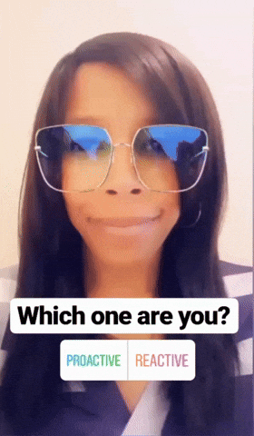
  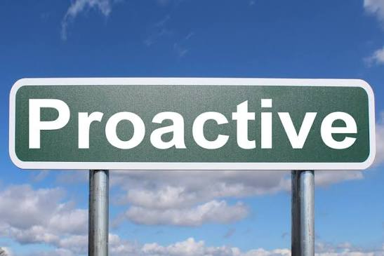

### The Circle of Concern vs. the Circle of Influence

Covey offers a simple, powerful tool for locating your energy:

- **Circle of Concern** — everything you care about: your health, family, work, the economy, world events. Much of it you *cannot control*.
- **Circle of Influence** — the smaller subset of those things you can *actually do something about*.

**Where you focus determines your effectiveness:**

- **Proactive people** work inside their **Circle of Influence**. That positive energy causes the circle to **expand**—they steadily gain more influence.
- **Reactive people** obsess over the **Circle of Concern**—others' faults, problems beyond their control. That negative energy, combined with neglect of what they *could* affect, causes their Circle of Influence to **shrink**.

### Three Kinds of Problems

Everything we face falls into one of three categories, each with a proactive response:

1. **Direct control** (our own behavior) — solved by working on our habits (Habits 1–3).
2. **Indirect control** (other people's behavior) — solved by improving our methods of influence (Habits 4–6).
3. **No control** (the past, unchangeable realities) — solved by changing our **attitude**: genuinely accepting, smiling, and learning to live with these things peacefully.

In every case, the first step is inside our Circle of Influence.

  
  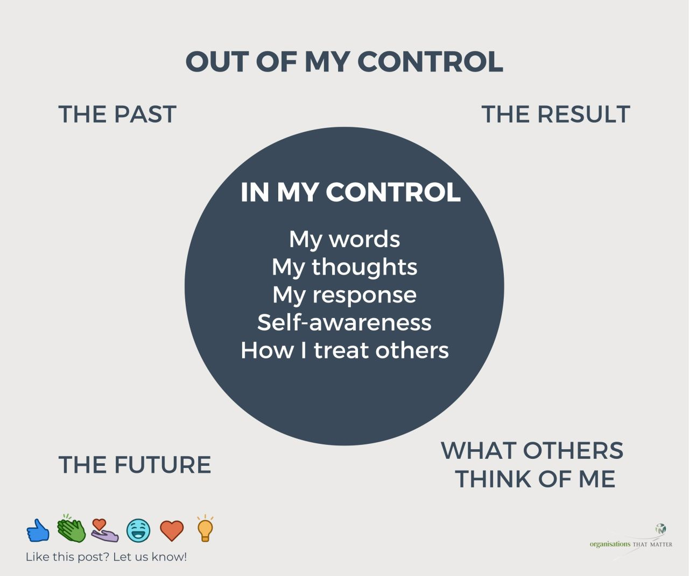

### Commitments, Mistakes, and Integrity

The essence of proactivity is **making and keeping commitments to ourselves and others**—the core of personal integrity and growth. And when we make mistakes, the proactive response isn't to deny, defend, or blame; it's to **acknowledge it, correct it, and learn from it.** Covey notes that it's not the mistake itself that wounds us most, but our reaction to it.

### The Bottom Line

Be Proactive means recognizing that you are the **programmer**, not the program—responsible for your own choices and, ultimately, your own life. It's the first habit because none of the others are possible until you accept that responsibility.

---

## 4. Habit 2: Begin with the End in Mind — The Principle of Vision

If Habit 1 says *you* are the creator, Habit 2 asks: **creator of what?** It's about starting with a clear picture of your destination, so every step actually moves you toward it.

### All Things Are Created Twice

Everything is created **twice**—first a **mental creation**, then a **physical creation**. A building starts as a blueprint before a single brick is laid; a business starts as a plan before it opens. If you don't consciously author the **first creation**, someone or something else will—family scripts, social pressure, circumstance. Habit 2 is about taking charge of that first creation deliberately.

### Leadership Before Management

Covey draws a sharp line: **"Management is doing things right; leadership is doing the right things."**

His metaphor: a crew hacking a path through the jungle. The **workers** swing the machetes. The **managers** sharpen the blades, write manuals, and improve efficiency. But it's the **leader** who climbs the tallest tree, surveys the whole scene, and shouts—*"Wrong jungle!"* You can be incredibly efficient (great management) while heading in entirely the wrong direction (no leadership). Effectiveness requires **leadership first**—making sure the ladder is leaning against the right wall before you climb it.

### Visualizing the End: The Funeral Exercise

Covey's signature exercise: picture your own funeral years from now. Imagine what you'd want a **family member, a friend, a colleague, and someone from your community** to say about the person you were. What character, contributions, and relationships would you hope they describe? Your honest answers reveal your **deepest values**—your true definition of success—and give you the "end" to begin with.

  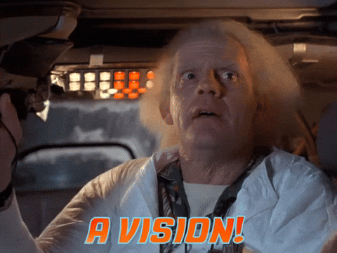
  

### The Personal Mission Statement

The most powerful way to live Habit 2 is to write a **personal mission statement**—a personal constitution built on **principles**. It defines:

- What you want to **be** (character),
- What you want to **do** (contributions and achievements), and
- The **values and principles** those are grounded in.

Because it's rooted in unchanging principles, it becomes a **stable standard**—a fixed reference point for making decisions amid change. You write it using two of the human endowments from Habit 1: **imagination** (to envision) and **conscience** (to align with principle).

### The Bottom Line

Begin with the End in Mind means defining success **on your own principled terms** and writing the script for your life before you live it—so your daily efforts, however efficient, are actually climbing the *right* wall.

---

## 5. Habit 3: Put First Things First — The Principle of Prioritization

Habits 1 and 2 are about deciding; Habit 3 is about **doing**. It's the **second creation**—the day-to-day execution that turns proactivity (Habit 1) and vision (Habit 2) into reality through disciplined action. Covey sums it up: **organize and execute around priorities.**

### The Time Management Matrix

Every activity can be sorted by two factors: how **urgent** it is (it demands attention *now*) and how **important** it is (it contributes to your mission and values). That creates four quadrants:

| | Urgent | Not Urgent |
|---|---|---|
| **Important** | **Q1 — Necessity** crises, pressing problems, deadline-driven work | **Q2 — Effectiveness** planning, prevention, relationship-building, growth, new opportunities |
| **Not Important** | **Q3 — Deception** interruptions, many calls/emails, some meetings | **Q4 — Waste** trivia, busywork, time-wasters |

  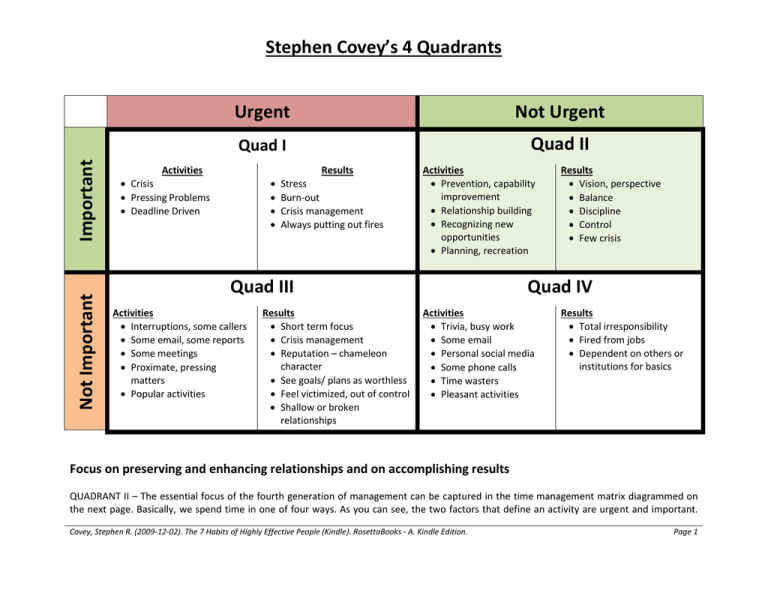
  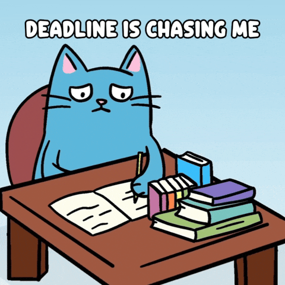

### Quadrant II Is the Heart of Effectiveness

Most people live reactively in **Q1** (constant firefighting) and escape into **Q4**, while mistaking **Q3's** urgency for importance. The problem: urgency is seductive, but it isn't the same as importance.

The key to effectiveness is **Quadrant II**—the important-but-not-urgent work of planning, prevention, and relationships. It rarely shouts for attention, so it's easily neglected—yet investing here is exactly what **shrinks Q1**: the more you prevent and prepare, the fewer crises you face. Effective people deliberately spend their time in Q2.

### Learning to Say "No"

The time for Q2 has to come from somewhere—and it comes from cutting **Q3 and Q4**. That means learning to say **"no"** to the unimportant. Covey's insight: you can only say no calmly when you have a bigger, burning **"yes"** inside—a clear sense of your priorities (from your Habit 2 mission) that makes the trade-offs obvious.

### Delegation: Multiplying Your Time

A major lever for Q2 is **delegation**. Covey distinguishes two kinds:

- **Gofer delegation** — "go for this, go for that, then report back." You dictate every step and stay in control of the method, treating the other person as a pair of hands rather than a capable partner. Because you're still directing each move, it barely lightens your load—you remain the bottleneck, and the person never learns to think for themselves. It doesn't scale: the more people you delegate to this way, the more exhausting supervision becomes.
- **Stewardship delegation** — you focus on **results, not methods**, and give the other person ownership. It rests on clear mutual understanding of five things: **desired results, guidelines, resources, accountability, and consequences.** Once those are agreed, the person is free to choose *how* they get there and becomes accountable for the outcome, which builds trust and capability over time. It takes more effort and patience up front, but it frees you completely once it's working. This is the delegation that grows people—done well, they often produce results better than you would have yourself.

Stewardship delegation is what truly multiplies your effectiveness, freeing you for the high-value work only you can do.

### The Bottom Line

Put First Things First is the discipline of executing on what matters most instead of what merely feels urgent. Live in **Quadrant II**, guard it with a well-practiced "no," and delegate the rest—so your days actually reflect the priorities you defined in Habits 1 and 2.

---

## 6. Paradigms of Interdependence — The Emotional Bank Account

This is the bridge into the **Public Victory**. Before diving into Habits 4–6, Covey establishes the paradigm that makes them possible.

### Private Victory Precedes Public Victory

Habits 4–6 are about **interdependence**—working effectively with others—but you can't get there by skipping ahead. **Independence (the Private Victory of Habits 1–3) must come first.** People who try to have rich relationships without first mastering themselves inevitably fail, because you can't build a healthy relationship with others until you have one with yourself.

Covey stresses that the foundation of every relationship is **who you are**, not the techniques you use. If your character is fundamentally flawed—duplicitous, insincere—no communication trick will paper over it for long. Character comes first.

### The Emotional Bank Account

Covey's central metaphor for interdependence is the **Emotional Bank Account (EBA)**—the amount of **trust** built up in a relationship. Just like a financial account, you make **deposits** (that build trust) and **withdrawals** (that erode it):

- When the balance is **high**, communication is easy, instant, and forgiving. Trust covers small mistakes.
- When the account is **overdrawn**, you're walking on eggshells—every word is measured, and the relationship is tense and defensive.

The key insight: trust isn't built once and left alone. It requires **continuous deposits**, because relationships involve ongoing interaction and expectations that quietly evaporate over time.

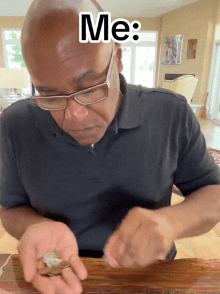

### Six Major Deposits

Covey identifies six deposits that build the account:

1. **Understanding the individual** — genuinely knowing what matters to the *other* person. What counts as a deposit to you may be a withdrawal to them, so you must understand them on *their* terms.
2. **Attending to the little things** — small kindnesses and courtesies are big deposits; small discourtesies and unkindnesses are big withdrawals.
3. **Keeping commitments** — keeping a promise is a major deposit; breaking one is a major withdrawal that's hard to recover from.
4. **Clarifying expectations** — unclear or unmet expectations quietly drain trust; making expectations explicit upfront prevents misunderstandings.
5. **Showing personal integrity** — being honest, keeping your word, and being **loyal to those who are absent**. Integrity is what makes the other five deposits credible.
6. **Apologizing sincerely when you make a withdrawal** — a genuine "I was wrong" is a deposit; but repeated apologies with no change become withdrawals.

### The Bottom Line

Interdependence is built on **trust**, and trust is built one deposit at a time. Before you can practice the Public Victory habits, you have to invest in the relationship itself—tending the Emotional Bank Account so there's a reserve of trust to draw on when it matters.

---

## 7. Habit 4: Think Win/Win — The Principle of Mutual Benefit

The first Public Victory habit. **Win/Win** is a frame of mind and heart that constantly seeks **mutual benefit** in every interaction. It's not your way or my way—it's a *better* way, one where everyone comes out ahead.

### The Six Paradigms of Human Interaction

Covey lays out six ways people approach their dealings with others:

1. **Win/Win** — both parties benefit; agreements and solutions are mutually satisfying. Cooperation, not competition.
2. **Win/Lose** — "If I win, you lose." The competitive, authoritarian mindset most of us are scripted into from childhood (grades, sports, comparison).
3. **Lose/Win** — "I lose, you win." The doormat: appeasing, giving in, no standards or expectations. Often masks buried resentment.
4. **Lose/Lose** — both go down. What happens when two Win/Lose people clash and both become vindictive—"if I can't win, neither can you."
5. **Win** — you just want your own win and don't care what happens to the other person.
6. **Win/Win or No Deal** — if you can't reach a solution that benefits both, you agree to **disagree agreeably**: No Deal.

  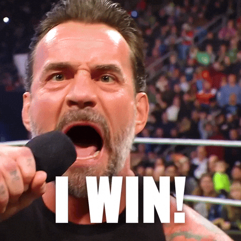
  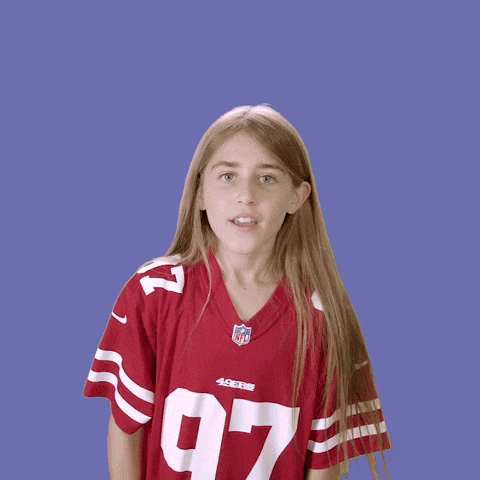

### Win/Win or No Deal

Covey calls **Win/Win or No Deal** the highest and most freeing paradigm. Knowing that "No Deal" is an option removes the pressure to manipulate or settle for a bad outcome—you can be genuinely open because you're not trapped into forcing an agreement. In truly interdependent, ongoing relationships, **Win/Win is the only viable long-term option**; anything less quietly drains the Emotional Bank Account.

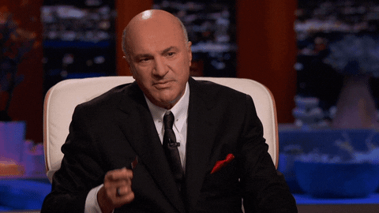

### The Abundance Mentality

At the heart of Win/Win is a mindset shift:

- **Scarcity Mentality** — sees life as a zero-sum pie: the more you get, the less there is for me. It makes people hoard credit, recognition, and success, and struggle to be happy for others.
- **Abundance Mentality** — flows from a deep sense of personal worth and security: there's **plenty out there for everybody**. It celebrates others' success and makes genuine mutual benefit possible.

Only from abundance can you sincerely want the other person to win too.

### Five Dimensions of Win/Win

Win/Win isn't just a technique—it's a whole system with five interdependent parts:

1. **Character** — the foundation, resting on **integrity**, **maturity** (the balance of courage *and* consideration—expressing your own convictions while respecting others'), and the **abundance mentality**.
2. **Relationships** — built on the trust of the Emotional Bank Account; high trust is what makes Win/Win achievable.
3. **Agreements** — clear Win/Win agreements defining desired results, guidelines, resources, accountability, and consequences (the same five elements as stewardship delegation).
4. **Systems** — the surrounding systems (especially rewards) must *reinforce* Win/Win. You can't reward internal competition and expect cooperation.
5. **Processes** — you can only reach Win/Win outcomes through Win/Win processes (which lead directly into Habits 5 and 6).

### The Bottom Line

Think Win/Win means approaching relationships from **abundance rather than scarcity**, seeking solutions where everyone benefits—and being willing to walk away ("No Deal") when they don't. It's the mindset that makes genuine cooperation, and the next two habits, possible.

---

## 8. Habit 5: Seek First to Understand, Then to Be Understood — The Principle of Empathic Communication

Covey calls this **the single most important principle in interpersonal relations.** We spend years learning to read, write, and speak—but almost no time learning to *listen*. This habit fixes the order: understand first, then be understood.

### We Listen to Reply, Not to Understand

Most people don't listen with the intent to *understand*—they listen with the intent to *reply*. While the other person is talking, we're already preparing our response, filtering everything through our own **autobiography** (our experiences, biases, and frame of reference). We project our own story onto their situation and call it listening.

### Diagnose Before You Prescribe

Covey's analogy: a doctor who prescribes before diagnosing is committing malpractice. The same is true in communication—**you can't offer a real solution or influence anyone until you deeply understand their situation first.** Prescribing before diagnosing destroys trust; diagnosing first builds it.

### The Four Autobiographical Responses

Because we respond from our own frame of reference, we tend to react in four unhelpful ways:

1. **Evaluate** — we agree or disagree.
2. **Probe** — we ask questions from our *own* point of view.
3. **Advise** — we give counsel based on our *own* experience.
4. **Interpret** — we try to figure people out based on our *own* motives and behavior.

All four keep us stuck inside our own head instead of entering theirs.

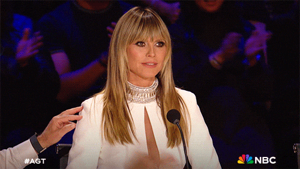

### Empathic Listening

The alternative is **empathic listening**—listening with the intent to understand, both emotionally and intellectually. You get inside the other person's frame of reference and see the world as *they* see it. It doesn't mean you agree; it means you fully, deeply understand.

Covey's key idea: being understood is a form of **"psychological air."** Just as you can't think about anything else when you're starved of air, a person who doesn't feel understood can't move toward problem-solving. Once that need is met, the defensiveness drops and real dialogue becomes possible.

### Then Seek to Be Understood

The second half matters too—**maturity is courage balanced with consideration.** Once you've genuinely understood, you've earned the credibility to present your own ideas clearly and be understood in return. Covey frames effective persuasion through the Greek concepts, *in order*:

- **Ethos** — your personal credibility and character.
- **Pathos** — empathy; alignment with the other person's feelings.
- **Logos** — the logic and reasoning of your argument.

Most people skip straight to **logos** (their argument) and wonder why they aren't persuasive. Effectiveness requires ethos and pathos *first*.

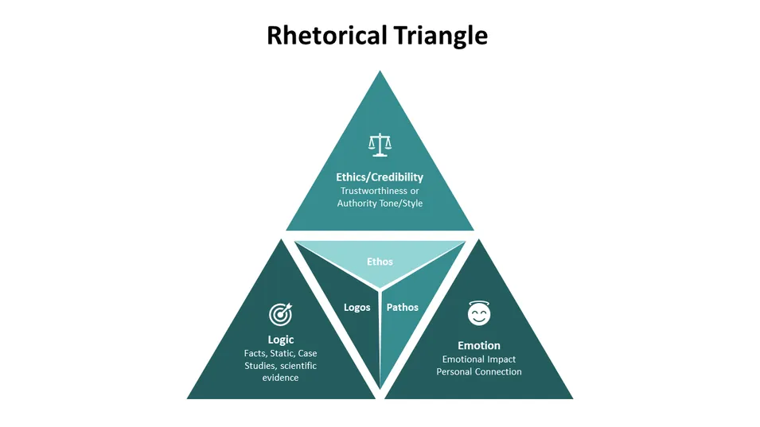

### The Bottom Line

Seek First to Understand means listening empathically to give others the "psychological air" of feeling truly understood—*then* presenting your own view. It's risky (you must be open to being influenced yourself), but it makes the largest deposits in the Emotional Bank Account and unlocks genuine problem-solving.

---

## 9. Habit 6: Synergize — The Principle of Creative Cooperation

Synergy is the **crowning achievement** of the Public Victory—what happens when you combine everything from the previous habits. It's the payoff of Win/Win (Habit 4) and empathic listening (Habit 5) working together.

### What Is Synergy?

Simply put, **synergy means the whole is greater than the sum of its parts**—**1 + 1 = 3** (or more). It's creative cooperation: when people combine their strengths, they produce something none of them could have created alone. Covey notes it's everywhere in nature—the relationship *between* the parts becomes a powerful part in itself.

### Valuing the Differences

The **essence of synergy is to value differences**—in perception, opinion, and experience. Two people can see the same thing differently and *both be right* (Covey uses the famous "young woman / old woman" optical illusion). Synergy comes from the humility to recognize your own perceptual limits and genuinely appreciate what another mind can add. As Covey puts it, **if two people have the exact same opinion, one of them is unnecessary.** Differences aren't obstacles—they're the raw material of better solutions.

### Levels of Communication

Covey describes three levels, rising with trust and cooperation:

1. **Defensive (low)** — low trust, protective, win/lose posturing. People guard themselves.
2. **Respectful (middle)** — mature, polite communication that ends in **compromise**: 1 + 1 = 1.5. Both sides give something up; nobody gains something new.
3. **Synergistic (high)** — high trust and openness, producing solutions **better than anything either party originally proposed.**

### The Third Alternative

The heart of synergy is the search for a **third alternative**—not "my way," not "your way," but a **better way** that neither person had thought of before. This requires the security (from an abundance mentality) to be open to influence and stay in the discomfort of not-yet-knowing the answer. **Fear and scarcity kill synergy**; security and openness create it.

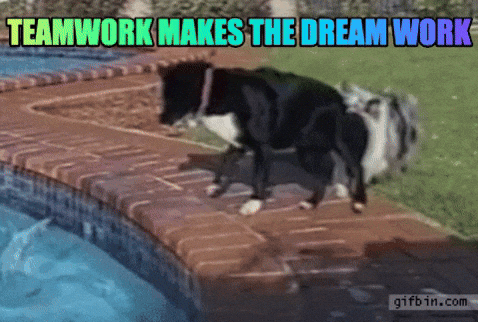

### The Bottom Line

Synergize means valuing differences and cooperating creatively so that together you reach a **third alternative**—an outcome greater than the sum of the individual contributions. It's the practical fruit of all the interpersonal habits combined.

---

## 10. Habit 7: Sharpen the Saw — The Principle of Balanced Self-Renewal

The final habit **surrounds and sustains all the others.** It's about preserving and enhancing the greatest asset you have—**yourself.** In P/PC terms, this is pure investment in your own Production Capability.

### Sharpening the Saw

Covey's parable: a man is sawing down a tree, sweating and exhausted, making little progress with a dull blade. A passerby suggests he pause to sharpen the saw. "I don't have time to sharpen the saw," he replies, "I'm too busy sawing!" That's how most people treat self-renewal—too busy producing to maintain the one instrument doing all the work.

  
  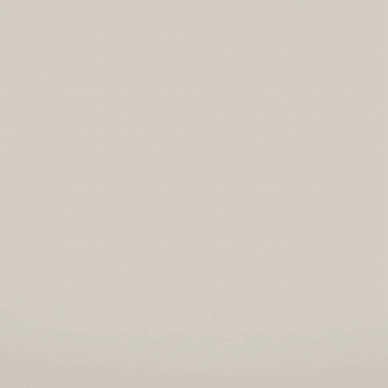

### The Four Dimensions of Renewal

Covey says we must renew ourselves in four dimensions, and **balance across all four** is what matters:

1. **Physical** — exercise, good nutrition, and stress management. Caring for your body. *(Enables Habit 1.)*
2. **Mental** — reading, writing, planning, and continuous learning to keep the mind sharp. *(Enables Habit 2.)*
3. **Social/Emotional** — building relationships through service, empathy, and synergy; developing intrinsic security. *(Enables Habits 4, 5, and 6.)*
4. **Spiritual** — clarifying and committing to your values through reflection, meditation, time in nature, or study. Renewing your connection to your core. *(Enables Habit 2.)*

Renewal is the ultimate **Quadrant II activity** (important but never urgent)—which is exactly why it's so easily neglected, and so powerful when you protect it.

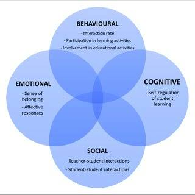

### The Upward Spiral

Growth isn't a flat circle but an **upward spiral.** Renewing one dimension strengthens the others, and each turn of *learn → commit → do*—guided by conscience—lifts you to a higher plane. Sharpening the saw in all four dimensions keeps the other six habits sharp and moves you continually upward.

### The Bottom Line

Sharpen the Saw is the habit of **balanced self-renewal**—investing in your body, mind, heart, and spirit so you have the capacity to live all the other habits. Neglect it and everything else dulls; protect it and you set off an upward spiral of continuous growth.

---

## 11. Inside-Out Again — Living the Habits

Covey closes the book where he began: with the **inside-out** principle. The seven habits aren't a set of techniques to apply to others—they're an integrated approach that starts by changing *yourself*, from your character and paradigms outward.

### Effectiveness Comes from Living by Principles

Covey reaffirms his central claim: lasting effectiveness flows from aligning your life with **correct principles**—natural laws like integrity, fairness, and growth that are timeless and self-evident. The Personality Ethic's shortcuts can't substitute for this. When you live in harmony with principles, the seven habits stop being effortful techniques and become who you *are*.

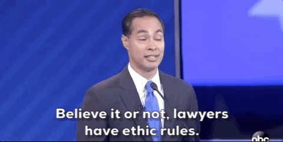

### Becoming a Transition Person

One of the chapter's most powerful ideas: we all inherit **"scripts"**—patterns of behavior, belief, and dysfunction passed down through families and generations. But because we're proactive (Habit 1), we don't have to pass them on. You can become a **"transition person"**—someone who stops negative scripts at themselves and hands down positive, principle-centered ones instead. A single person can change the trajectory of generations that follow.

### A Continual Process, Not a Destination

The habits aren't a one-time achievement but an ongoing **upward spiral** of renewal and growth. You never "arrive"; you keep moving through *learn → commit → do* at higher and higher levels. Growth is a lifelong process of working from the inside out, again and again.

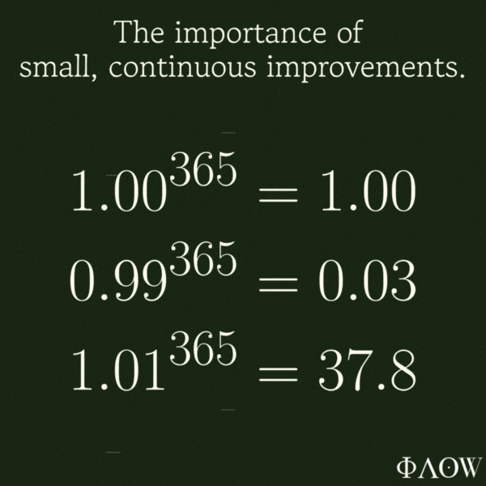

### The Bottom Line

*Inside-Out Again* brings the book full circle: real, lasting change starts within, is built on timeless principles, and never truly ends. Live the habits from the inside out, become a transition person, and commit to continual renewal—that's the path to genuine effectiveness and inner peace.

---

## Action Items & Takeaways

Before getting into Action Items, let's revise the 7 habits and their takeaways:

- **Habit 1 (Be Proactive):** Catch yourself using reactive language ("I have to," "he makes me…") and swap it for proactive language ("I choose to," "I control my response"). Focus your energy on your **Circle of Influence**.
- **Habit 2 (Begin with the End in Mind):** Write a first draft of your **personal mission statement** — what you want to *be*, *do*, and the principles behind both.
- **Habit 3 (Put First Things First):** Each week, schedule your **Quadrant II** priorities (important, not urgent) *first*, and practice saying "no" to Q3/Q4 distractions.
- **Habit 4 (Think Win/Win):** Go into your next negotiation or disagreement looking for mutual benefit — and keep "**No Deal**" as an honest option.
- **Habit 5 (Seek First to Understand):** In your next important conversation, listen **empathically** — don't reply, advise, or evaluate until the other person feels fully understood.
- **Habit 6 (Synergize):** When you hit a clash of views, resist compromise and hunt for the **third alternative** — a better solution neither side had alone.
- **Habit 7 (Sharpen the Saw):** Build a daily/weekly renewal routine touching all four dimensions — **physical, mental, social/emotional, spiritual**.

### Action Items

- [ ] Create goals for **1 month, 3 months, 1 year, and 5 years**.
- [ ] Create your **priority matrix** to achieve those goals.
- [ ] **First help people**, then seek help from them.
- [ ] **Sharpen the saw** across all four domains:
  - [ ] **Physical Health** — exercise and nutrition
  - [ ] **Mental Strength** — upgrade skills, discipline, and self-control
  - [ ] **Emotional** — strong connections and networking
  - [ ] **Spiritual** — charity and volunteering

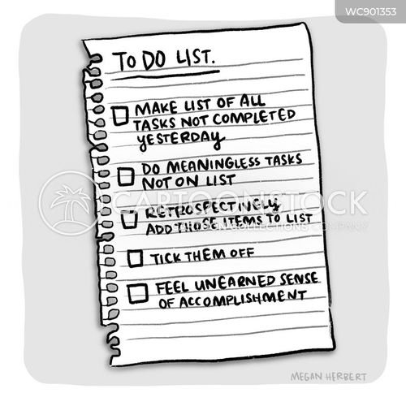

**Biggest mindset shift:** Effectiveness is **inside-out** — you can't change your circumstances or relationships until you change your own character and paradigms first. Principles, not personality tricks, produce lasting results.

**Pass it on:** The most powerful takeaway to share is becoming a **transition person** — you can stop the negative "scripts" you inherited and hand the people around you better ones instead. Start with one habit, model it, and let others catch it.

---
